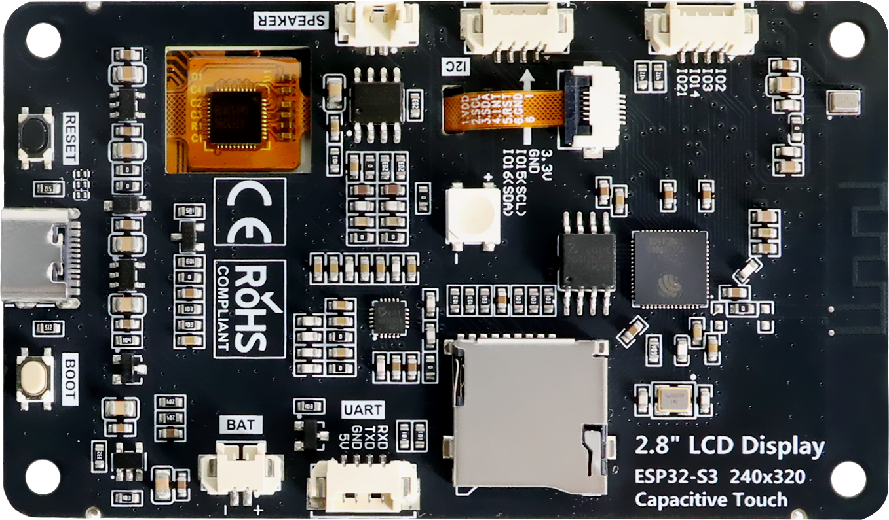
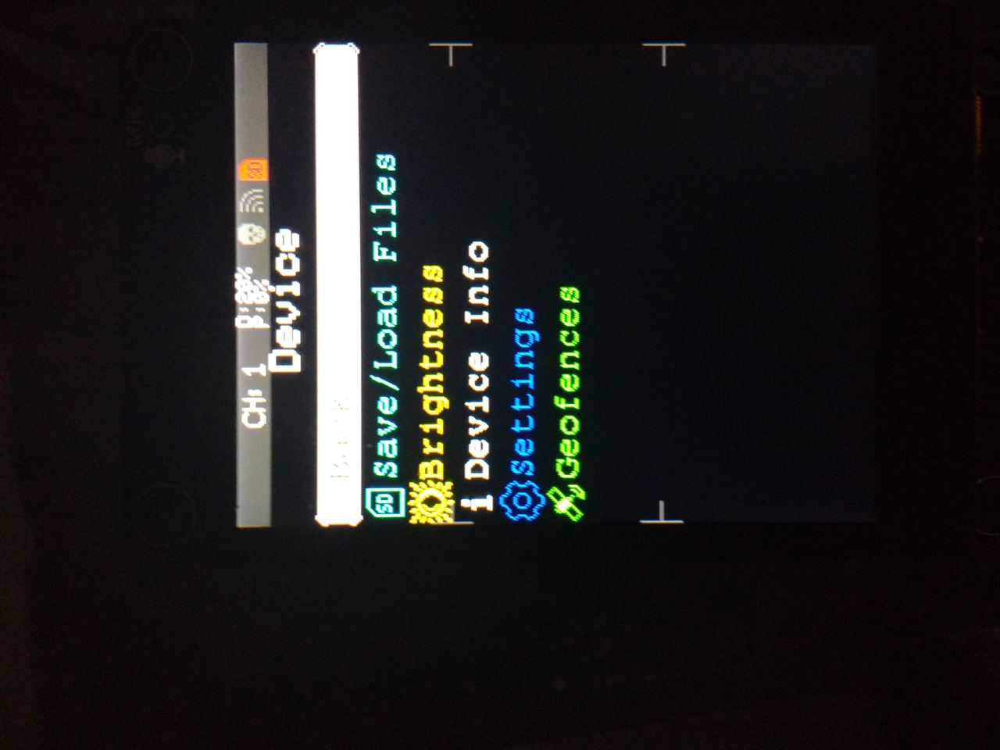

# Maramau - Marauder for Freemove S3

`Maramau` is a port of the [ESP32Marauder](https://github.com/justcallmekoko/ESP32Marauder) firmware to the **Freenove / Freemove ESP32-S3 Display (FNK01044B / FNK0104B, 2.8" variant, CYD-style form factor)**.

This repository is based on upstream ESP32Marauder by **Just Call Me Koko**. Upstream attribution and the MIT license are preserved (see [License and attribution](#license-and-attribution)).

> **Status: beta.** The features tested on this board work as expected. If you encounter malfunctions, missing features, or bugs, please open an issue to report them (see [Known limitations](#known-limitations-fnk01044b-28-beta) and [Roadmap / TODO](#roadmap--todo)).

## Target hardware

- Board: Freenove / Freemove ESP32-S3 Display **FNK01044B / FNK0104B** (2.8")
- MCU: ESP32-S3 (N16R8), 16 MB flash, 8 MB PSRAM (AP_3v3)
- Display: 2.8" IPS TFT, ILI9341, 240x320, SPI
- Touch: FT6336U capacitive touch, I2C
- Other peripherals on the board family: microSD slot, ES8311 audio, WS2812 NeoPixel, LiPo/USB power (TP4054), UART/GPS-capable pins



## Screenshot



## What is implemented in this port

- `MARAUDER_FREEMOVE_FNK01044B` board target (`esp32_marauder/configs.h`)
- ILI9341 SPI display configuration and backlight control (GPIO45)
- FT6336U capacitive touch (I2C: SDA=16, SCL=15, INT=17, RST=18)
- Wi-Fi, Bluetooth (NimBLE), menu/UI, Evil Portal, and other upstream Marauder features enabled by the target configuration
- NeoPixel pin mapping (GPIO42)
- Battery level reading via ADC (`BAT_ADC` / GPIO9, 2:1 divider) shown in the status bar

## Flashable binaries

Prebuilt binaries for **FNK01044B 2.8" (ESP32-S3)** are in [`firmware/fnk01044b_s3_2.8/`](firmware/fnk01044b_s3_2.8/):

| File | Flash offset | Notes |
|---|---:|---|
| `maramau_fnk01044b_s3_2.8_FULL.bin` | `0x0` | **Recommended:** merged image (bootloader + partitions + app) |
| `bootloader.bin` | `0x0` | Use with partitions + app |
| `partitions.bin` | `0x8000` | Use with bootloader + app |
| `maramau_fnk01044b_s3_2.8.bin` | `0x10000` | Application only (do not flash alone to `0x0`) |

Flash the merged image (replace `/dev/ttyACM0` with your serial port):

```bash
python -m esptool --chip esp32s3 -p /dev/ttyACM0 -b 460800 write-flash 0x0 firmware/fnk01044b_s3_2.8/maramau_fnk01044b_s3_2.8_FULL.bin
```

## Known limitations (FNK01044B 2.8" beta)

- **SD card:** disabled in this beta. On the FNK01044B 2.8" test unit, SD initialization (`SD.begin`, `SD_CS=21`, shared SPI) blocked boot; SD init is therefore skipped for this target until the correct wiring/bus sharing is confirmed.
- **GPS:** enabled in configuration (UART pins mapped in `configs.h`), but not validated on hardware without an attached GPS module.
- **Battery:** percentage is derived from `BAT_ADC` (GPIO9, 2:1 divider, linear estimate 3.30–4.15 V). It is an estimate and can be inaccurate under load. Charging status (TP4054 `CHRG`) is not mapped to an ESP32 GPIO on this board, so a dedicated charging indicator is not available.
- **PSRAM:** ✅ resolved. The module is an ESP32-S3 N16R8 with 8 MB **Octal (OPI)** PSRAM; it now initializes correctly (`psramInit()` succeeds, status bar shows `P:` usage). The build uses `board_build.arduino.memory_type = qio_opi`.
- **USB CDC serial / flashing:** flashing over native USB CDC (`/dev/ttyACM0`) is reliable with `esptool.py --no-stub` at default baud (921600 triggers a native-USB stall). Persistent serial logging over CDC works after boot.

## Build and flash (from source)

Requirements: [PlatformIO Core](https://platformio.org/) and an ESP32-S3 toolchain (this project uses `espressif32@6.7.0` / Arduino 2.0.16).

```bash
cd esp32_marauder
pio run -e freenove_fnk01044b_s3
```

Build outputs (after a successful build):
- `esp32_marauder/.pio/build/freenove_fnk01044b_s3/bootloader.bin` (`0x0`)
- `esp32_marauder/.pio/build/freenove_fnk01044b_s3/partitions.bin` (`0x8000`)
- `esp32_marauder/.pio/build/freenove_fnk01044b_s3/firmware.bin` (`0x10000`)

Flash with esptool:

```bash
python -m esptool --chip esp32s3 -p /dev/ttyACM0 -b 460800 \
  write-flash 0x0 esp32_marauder/.pio/build/freenove_fnk01044b_s3/bootloader.bin \
               0x8000 esp32_marauder/.pio/build/freenove_fnk01044b_s3/partitions.bin \
               0x10000 esp32_marauder/.pio/build/freenove_fnk01044b_s3/firmware.bin
```

If the device boot-loops after flashing only the app, flash bootloader + partitions + app together, or flash the merged image at `0x0`.

## Roadmap / TODO

- Create and validate ports for the **Freenove ESP32-S3 Display 3.5"** and **4.0"** variants.
- Re-enable and validate **microSD** on FNK01044B (confirm CS/wiring and SPI bus sharing with TFT/touch).
- Investigate **PSRAM** initialization.
- Validate **GPS** behavior with an attached module and confirm UART pin mapping for this board.
- Improve **battery** reporting (calibration/averaging); add charging indication if a usable signal is identified.
- General refinement and testing of the current 2.8" firmware.

## Repository layout

- `esp32_marauder/` — firmware source and PlatformIO project (env: `freenove_fnk01044b_s3`)
- `firmware/fnk01044b_s3_2.8/` — prebuilt flashable binaries (merged + split)
- `User_Setup_maramau_freenove_s3_28.h`, `User_Setup_Select.h` — TFT_eSPI setup used by this port
- `docs/images/` — board and screenshot images used by this README

## License and attribution

- **Upstream:** [ESP32Marauder](https://github.com/justcallmekoko/ESP32Marauder) by Just Call Me Koko. This is a derivative/port; upstream attribution is retained.
- **ESP32Marauder / Maramau source in this repository:** [MIT License](LICENSE) (upstream copyright notice preserved).
- **Third-party libraries:** see upstream/library licenses. Note: ESPAsyncWebServer is LGPL-3.0, which has implications for distributing compiled binaries.
- **Freenove board image:** `docs/images/FNK0104B_Bottom.png` is from the [Freenove ESP32-S3 Display repository](https://github.com/Freenove/Freenove_ESP32_S3_Display) (CC BY-NC-SA 3.0). It is used here for hardware identification only.

This project is not affiliated with or endorsed by Just Call Me Koko, ESP32Marauder, Freenove, or Freemove.

## Issues and feedback

The functionality tested on the FNK01044B 2.8" hardware works as expected. If you find malfunctions, missing features, or bugs, please report them by opening a GitHub issue with your board variant, firmware version/build, steps to reproduce, and observed behavior.

## Disclaimer

Use this firmware only on networks and devices you own or have explicit permission to test. You are responsible for complying with applicable laws and regulations.
